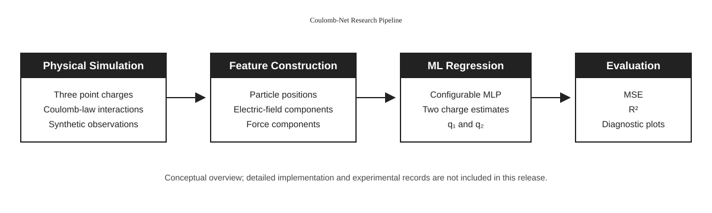
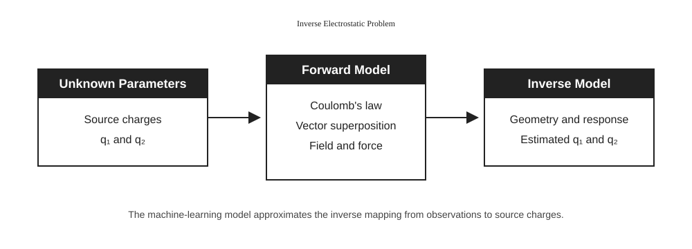

# Coulomb-Net

## Project overview

Coulomb-Net is a research project on the inverse electrostatic problem. It
investigates whether two unknown source charges can be estimated from
simulated electromagnetic observations in a three-particle system.

The project combines:

- Coulomb-law-based physical simulation;
- synthetic data generation;
- machine-learning regression;
- evaluation with statistical metrics and diagnostic visualizations.

The physical system contains two source charges and one target charge. Particle
positions, electric-field components, and force components are used to model
the relationship between the physical configuration and the unknown source
charges.

## Research approach

The forward problem calculates the electric field and force produced by known
charges. The inverse problem uses the resulting observations and particle
geometry to estimate the source charges.

The project investigates a configurable multilayer perceptron and compares its
regression behavior with conventional machine-learning baseline models.
Evaluation examples include model comparison, predicted and reference values,
and training/validation loss plots.

## Project materials

### Conceptual diagrams

- [Forward and inverse physical problems](diagrams/physics/)
- [Research pipeline and inverse-problem maps](diagrams/architecture/)





### Educational demonstration

The independent [Coulomb field demo](demo/coulomb_field_demo.py) illustrates
the superposition of electric fields generated by two point charges.

```bash
python -m pip install -r demo/demo_requirements.txt
python demo/coulomb_field_demo.py
```

### Evaluation examples

The [results](results/) directory contains selected figures from
development-stage experiments:

- [Model comparison](results/model_comparison_preliminary.png)
- [Predictions](results/predictions_preliminary.png)
- [Training loss](results/training_loss_preliminary.png)

These figures are provided to illustrate the evaluation process and should not
be interpreted as the final validated performance of the project.

## TÜBİTAK support and research status

This project is supported by the Scientific and Technological Research Council
of Türkiye (TÜBİTAK) under the 2209-A University Students Research Projects
Support Programme.
